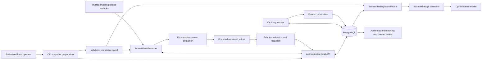

# Threat Model and Security Boundaries

Status: **APPROVED controls; implementation proofs OPEN.** Test IDs refer to [06](06-EVALUATION-AND-RELIABILITY.md). The threat model defines required behavior, not a claim of passed tests or complete containment.

## Assets and actors

Protect source/confidential data, secrets embedded in source, local API/launcher/provider credentials, PostgreSQL data, human review integrity, scanner policies/DBs, CI token, host filesystem and Docker daemon.

Trusted: authorized operator, maintained platform code, configured policies, host launcher and approved supply-chain inputs. Partially trusted dependencies: scanners and their parsers; their outputs are always untrusted. Adversarial surfaces: target files/names/configuration, malicious local browser origins, scanner output and model output. Local OS administrator, Docker administrator and fully compromised host are outside the claimed protection boundary. Source authorization never implies content trust.

## Trust-boundary diagram

Launcher owns daemon authority on the trusted host. API, worker and scanner have no Docker authority. Scanner has no DB/API/provider credentials or network. Normalization may run in the launcher using pure adapter code; worker revalidates a sanitized envelope and alone performs fenced publication. The provider adapter is trusted code; model-generated calls have only scoped read tools. Browser, CLI and reports authenticate to the local API.

## Threat/control/proof matrix

| Threat | Required control | Proof and gate |
|---|---|---|
| Path traversal, link/junction escape, alternate streams and case collisions | Reject unsafe entries; canonical manifest; independent byte copies; platform-owned spool; safe mount resolution | T-SNAPSHOT, G3/2A |
| Copy-time mutation or spool replacement | Detect mutation, atomic publication, restrict writers, verify at use, protect active refs | T-SNAPSHOT, G3/2A |
| ZIP-slip/remote acquisition/SSRF | No arbitrary archive, path, URL or server clone input | T-SNAPSHOT/T-API, 2A; no archive extractor in MVP |
| Scanner exploit/host escape | Disposable non-root containers, read-only source/rootfs, no privilege escalation/capabilities/daemon, no egress, resource caps | T-ISOLATION, G4/2B; fixture-only fallback if unproven |
| Launcher becomes Docker proxy | Fixed profiles/images/paths/argv; separate capability credential; validate current invocation; no shell/user flags | T-LAUNCHER, G4/2B |
| Repo configuration hides findings | External trusted rules plus controlled cwd/environment/config discovery/ignore/inline suppression policy | T-POLICY, G5/2B |
| Command or parser injection | Fixed executable/argv without shell; bounded strict output schema/depth/strings; paths validated as data | T-LAUNCHER/T-ADAPTER, 2B |
| Poisoned/stale dependency data | Trusted updater without source mounted, immutable versioned DB/rule inputs, visible age/coverage | T-POLICY/T-ADAPTER, 2B |
| Stale attempt mutates state/findings/audit | Job lock plus current generation/token/expiry; all authoritative writes in one transaction | T-QUEUE/T-CRASH, G2/2A |
| Worker/launcher/scanner hang or crash | Independent heartbeat, hard deadline, lease expiry, bounded retry/backoff, orphan cleanup | T-CRASH/T-LAUNCHER, 2A/2B |
| Resource/disk exhaustion | Bound intake, bodies, files, output, findings, temporary storage, queue capacity, concurrency and retention | T-LIMITS, 2A/2B/5/7 |
| Source/secrets disclosed | Separate raw-source storage from sanitized records; minimize excerpts; secret metadata only; no raw logs; explicit hosted consent | T-LOG/T-DISCLOSURE, 1/2B/3/5 |
| Prompt injection from source/output | External authorization for scoped read tools, no shell/write/network tool, strict arguments, step/byte/token/cost limits | T-AGENT, G6/3 and G7/4 |
| Fabricated or unsupported recommendations | Validate citation snapshot/path/range, label uncertainty, abstain, human review | T-AGENT/T-EVAL, 3/4 |
| Browser attacks against localhost | Bearer auth, exact Origin/Host allowlists, no credential cookies by default, no token in bundle/URL/log | T-ACCESS, G1/1; T-UI/6 |
| Report XSS/terminal/log injection | Escape control characters and render untrusted descriptions/paths/Markdown inertly; no active raw HTML | T-LOG/T-DISCLOSURE/T-UI, 1/5/6 |
| Review overwrite/audit manipulation | Expected revision, atomic revision/current/audit write; trusted reviewer identity | T-REVIEW, G6/3 |
| CI escalation or target execution | Least privilege, pinned actions, no privileged untrusted checkout scripts, no fork provider keys, disabled persisted credentials | T-CI, G8/5 |
| Restore references wrong/missing source | Verify DB/spool manifest linkage; missing evidence is unavailable, never substituted | T-RESTORE, G10/7 |

Acceptance fixtures can contain malicious-looking source as inert data. Never execute untrusted target-repository code to test isolation. Use a maintained trusted probe harness inside the restricted environment to test denied capabilities; probes must not attempt destructive host exploits.

## Credentials and sensitive data lifecycle

| Data | Permitted locations | Forbidden locations/controls |
|---|---|---|
| Raw source and embedded secrets | Operator checkout, restricted immutable spool, scanner memory/read-only mount, bounded transient raw output | No automatic model/report/log transmission; retention, quotas and access control required |
| Raw scanner stdout/stderr | Bounded per-attempt process buffers or restricted transient files | Never durable DB/log payload; normalize/redact before submission; remove on deadline/cleanup |
| Sanitized findings/evidence | PostgreSQL, authenticated API, protected reports | Bound/redact all upstream strings including paths; exports are still potentially sensitive |
| Local API bearer token | Operator configuration and API authentication component | Never DB audit metadata, URL, browser bundle, scanner environment or logs |
| Launcher credential and job lease token | Trusted launcher/orchestration components | Never scanner containers, models or reports; stale token rejected |
| DB credential | API/ordinary worker/migration environment | Never scanner/model/report; do not log DSN or exception connection details |
| Hosted provider key | Trusted provider component only | Never model messages, source spool, scanner environment or trace |
| CI token | Minimal trusted CI step | No target scripts, exported artifacts, fork secrets or model requests |
| Hosted prompt/response | Consented sanitized excerpt, trusted provider memory, allowed sanitized persisted result | No raw suspected secrets; bound retention/traces and disclose provider behavior |

Developer `.env` values are operator-supplied, ignored and never copied into images or committed. `.env.example` contains names and empty/non-secret examples only. Do not treat synthetic tests as proof that arbitrary secrets or proprietary information can always be detected. Default hosted transmission is off.

Consent is specific to snapshot/triage/configuration/data scope and is checked again before sending. Retries cannot expand scope. Revocation prevents future sends but cannot retract data already transmitted. Retention policy must describe source, prompts/traces, reports, DB backups and spool backups separately. Local filesystem encryption is an operator property, not an application claim.

## Residual risks and release interpretation

Static scanners miss vulnerabilities and may produce false positives. Containers share important underlying infrastructure and cannot guarantee containment of arbitrary exploits. Redaction is imperfect. Hosted providers add transmission/retention risk. Local authentication protects application access, not a compromised local administrator. Appended audit rows are not cryptographically tamper-proof.

G4 failure means restricted-fixture mode only. Phase 7 may demonstrate that explicitly bounded mode if its limitation is accepted and visible; it must not claim untrusted scanning support. Production deployment, public service exposure, multi-tenancy and autonomous remediation need new threat models and approval.
