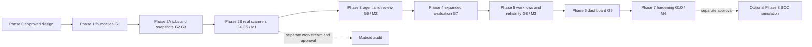

# Phases, Dependencies, Acceptance and Rollback

Status: **APPROVED scope; no implementation phase authorized.** Each phase requires its own explicit authorization and stops at its assigned boundary. Complexity: M = bounded component; L = substantial cross-component work; XL = highest implementation uncertainty. These are relative estimates, not delivery dates.

## Dependency graph

Passing a phase does not authorize the next. G4 has a restricted controlled-fixture fallback; that is not a passed untrusted-isolation test. A restricted M1/M4 must disclose that limitation. Initial safety tests are part of Phase 3, not deferred to Phase 4. UI cannot replace scanners or evaluations.

## Shared completion contract

Report changed files, approved scope, deviations, exact commands, pass/fail/skip counts, security evidence, remaining risks, rollback behavior and next handoff. Required integration tests may not be silently skipped. If environment/permissions prevent execution, record the blocked checks and do not claim the phase passed. No commits, pushes, deployments or remote activation without separate explicit approval. Never stage or modify local `AGENTS.md`.

Commands in [06](06-EVALUATION-AND-RELIABILITY.md) are future verification contracts, not work performed in Phase 0. Database tests use disposable PostgreSQL resources with explicit identity guards. Rollback never implies permission to destroy real data, clear the Docker host or reset the repository.

## Phase 1 — Foundation and DB lifecycle (M)

**Depends:** approved Phase 0 and explicit Phase 1 authorization. **Owns:** `pyproject.toml`, `uv.lock`, runtime pin, API/domain/storage foundation, initial migrations, local Compose/Docker configuration, foundation tests and local CI definition. Exact files/exclusions: [09](09-PHASE1-SPECIFICATION.md).

**Tasks:** locked Python stack; synchronous sessions; typed settings; authentication, Host/Origin rules; safe errors/logs/request correlation; liveness/readiness; initial project/snapshot/scan metadata and audit persistence; explicit migration command. Project create/query and read-only scan metadata only. No live scan acceptance or fake production seed data.

**Gate G1:** unit/API/real-PostgreSQL tests; lint/type checks; fresh migration, repeatable head, safe disposable downgrade/re-upgrade; schema mismatch readiness; create/query persistence after API/DB restart without volume deletion; loopback API/internal DB; no secret echo in validation/errors/logging. Compose is validated only after explicitly authorized service execution.

**Rollback:** stop API, preserve DB/volume, retain compatible schema. Rehearse initial downgrade only on disposable data; otherwise backup/forward-fix. **Handoff:** Phase 2A gets working storage/access controls but no queue consumers.

## Phase 2A — Durable orchestration and secure snapshot intake (L)

**Depends:** G1 and explicit Phase 2A authorization. **Owns:** `jobs/`, `snapshots/`, adapter protocol/fake scanner, minimal `cli/`, queue/idempotency/finding migrations and API acceptance/history. No Semgrep, Trivy or launcher execution.

**Tasks:** bounded immutable publication/registration with provenance and cleanup rules; minimal snapshot/submit/status CLI; atomic scan/scanner/job acceptance; idempotency hash/scope; SKIP LOCKED claim; generation/token/expiry; independent heartbeat; retry/deadline/recovery; transactional result/state/audit fence; fixed parent aggregation; cursor pagination and fake normalized findings.

**Gate G2/G3:** T-QUEUE/T-CRASH/T-SNAPSHOT/T-LIMITS; same key/body returns one resource, mismatch 409; races and lost HTTP response recover; at least 25 controlled crash/retry experiments with expected findings; stale heartbeat and all stale authoritative writes rejected; DB failures and max attempts recover deterministically; path/link/mutation cases fail closed. Real PostgreSQL multiprocess tests are mandatory.

**Rollback:** disable intake/claims, stop workers, preserve queued/attempt data and snapshots. Reconcile expired attempts before restarting. Do not erase stuck jobs to hide failures. **Handoff:** reliable fake-scanner system and validated source contract; no untrusted scanner claim.

## Phase 2B — Real scanners and isolation (XL)

**Depends:** G2/G3, explicit Phase 2B authorization and scanner/image/rule supply-chain inputs. **Owns:** host `runner/`, Semgrep/Trivy adapters, trusted `policies/`, real provenance/coverage, finding detail and JSON export.

**Tasks in order:** validate fixed-profile launcher boundary on actual Windows/Docker Desktop; integrate Semgrep; integrate Trivy; enforce trusted policy and offline database preparation; normalize/redact bounded outputs; preserve independent outcomes and partial findings; cleanup orphaned attempts.

**Gate G4/G5:** T-ISOLATION/T-LAUNCHER/T-POLICY/T-ADAPTER/T-DISCLOSURE; known-positive/clean SAST, dependency, synthetic secret and selected IaC/CI fixtures; no target execution; repo ignores/config/inline suppression cannot silently override audit policy; missing DB, parser errors, malformed/oversized output produce visible failures/coverage. No daemon authority in API/workers/scanners. Record exact runtime restrictions and test evidence.

**Fallback:** if G4 is unproven, enforce approved controlled-fixture allowlist and reject other input before launch. Report G4 open and restricted MVP capability; never claim the isolation gate passed. **Rollback:** disable affected adapters/launcher; preserve completed results and fake diagnostic path. **M1:** scanner MVP without LLM, with declared trust mode.

## Phase 3 — Working bounded agent and human review (L)

**Depends:** M1 and explicit Phase 3 authorization. Restricted-fixture mode propagates to source tools. **Owns:** `agent/`, triage/consent/review migrations, bounded evidence APIs/tools and revision-checked review UI-independent endpoints.

**Tasks:** deterministic provider; one separately opt-in hosted adapter; scoped read tools; structured result/abstention; citation validation; safety budgets and sanitized traces; idempotent triage queue independent of scanning; explicit consent; human revision history/audit.

**Gate G6:** T-AGENT/T-REVIEW/T-DISCLOSURE; a designated scenario genuinely needs finding inspection plus source/context retrieval; cross-snapshot access, injection and fabricated citations blocked; abstention demonstrated; hosted send denied without scoped consent; provider timeout/rate limit/invalid output preserve scan results; stale review 409 with no overwritten history; no auto-fix.

**Rollback:** disable provider/triage capability while scanning, exports and human review continue; cancel or mark pending triage unavailable through authorized state transitions. Preserve completed reviews. **M2:** working agentic triage, not merely a summary prompt.

## Phase 4 — Expanded quality and adversarial evaluation (M–L)

**Depends:** G6 and explicit Phase 4 authorization. **Owns:** labelled `evaluation/` corpus, manifests, held-out cases, evaluation harness and reports.

**Tasks:** at least 20 labelled source-only repository fixtures and 10 adversarial cases; distinct detectability/security labels; positive/negative near misses; held-out evaluation; scanner baseline and triage comparison; explicit denominators, abstention and uncertainty.

**Gate G7:** T-EVAL plus expanded T-AGENT/T-DISCLOSURE; reproducible offline results, confusion matrix only where labels support it, unsupported-remediation/evidence rates, cost/timing where measured, zero observed successful forbidden actions and synthetic disclosures. Hosted trials are separately identified and variable. No inflated detection-recall claim from triage alone.

**Rollback:** retain previous versioned manifests/results; disable a failing model/policy, fix and rerun unchanged held-out checks. Do not edit labels simply to improve scores. **Handoff:** measured limitations for developer workflow and demo.

## Phase 5 — Developer integration and reliability (L)

**Depends:** G7 and explicit Phase 5 authorization. **Owns:** complete `cli/`, `reporting/`, SARIF, policy exit codes, least-privilege GitHub workflow, workload/failure tests and operational diagnostics.

**Tasks:** scan/wait/query/export commands; deterministic sanitized JSON/SARIF; optional separately approved code-scanning upload; artifact fallback; severity policy separate from infrastructure failure; search/index tuning by EXPLAIN; queue/scan latency, recovery and resource measurements; clean-checkout CI with offline model.

**Gate G8:** T-CI/T-SARIF/T-LOAD/T-CRASH/T-LIMITS; valid SARIF with source mapping and coverage; no upload entitlement assumption; DB interruption, worker kill, provider outage and output limit handling; 1/2/4 worker cases where hardware supports them; report p50/p95 under a stated workload. Distinct CLI policy failure and operational failure exit codes. No privileged execution of target scripts.

CLI scan/wait policy exit contract: 0 = required scanning completed and configured finding policy passed; 1 = completed scanning failed the configured finding policy; 2 = invalid request, operational failure or incomplete required scanning. Incomplete required checks take precedence over finding thresholds. Triage unavailability alone does not turn a completed scan into a scan failure; triage commands report their own outcome. Coverage limits remain visible even for code 0; it is not a security guarantee.

**Rollback:** disable upload/policy enforcement independently, retain artifacts and diagnostic exports; restore prior compatible CLI if needed. Preparing a workflow is not approval to push or activate it. **M3:** strong technical portfolio checkpoint.

## Phase 6 — Minimal web reporting (M)

**Depends:** G8 and explicit Phase 6 authorization. **Owns:** `web/`, focused browser tests and authenticated API integration.

**Tasks:** scan history, filters, findings/evidence, human review with conflicts, queue/triage pending/failure views, accessible controls and small persisted metrics. Prefer same-origin deployment; development origin is an explicit allowlist. No token in bundle/URL or persistent browser storage by default.

**Gate G9:** T-UI/T-ACCESS; actual data, empty/error states, partial/incomplete scans visible, no fabricated metrics, safe hostile message/path/Markdown rendering, accessible core controls, revision conflict recovery. Offline mode must be labelled.

**Rollback:** disable UI serving; preserve CLI/API operation and data. **Handoff:** final end-to-end portfolio flow.

## Phase 7 — Hardening and flagship completion (L)

**Depends:** G9 and all applicable earlier gates; explicit Phase 7 authorization. **Owns:** final security/recovery suite, retention and restore evidence, rebuild/runbook, diagrams, demo and benchmark report.

**Tasks:** updated threat model, dependency/provenance review, source/output/backup retention, quota and active-reference cleanup, DB/spool backup/restore, bounded performance budgets, clean rebuild and factual resume metrics.

**Gate G10:** T-RESTORE plus complete in-scope security/recovery suite; matched source/DB restore, clean documented rebuild, no known unaddressed high-severity defects within declared scope, no real keys, no mock results presented as real detections. If G4 fallback remains, restricted mode is conspicuous and untrusted scanning is disabled; do not claim containment. All deviations/limits are reported for signoff.

**Rollback:** retain known-good application version plus compatible DB/spool backup; forward-fix schema when downgrade is unsafe. No destructive cleanup without verified targets and authorization. **M4:** complete flagship; no deployment implied.

## Phase 8 — OPTIONAL Prophet SOC simulation (separate authorization)

Only after Phase 7 signoff. Separate `soc/` module, schema/migrations, routes and fixtures; no required AppSec import or schema fields. Reuse infrastructure only through stable contracts. Two synthetic formats (identity and cloud IAM), idempotent replay, 2–3 fixed correlation patterns, evidence timeline and analyst feedback. No SIEM, live connectors, enterprise credentials or Kubernetes.

**Gate:** duplicate/out-of-order replay, two positive scenarios and a clean scenario, independent AppSec regression, evaluation and disable/removal test. **Rollback:** disable/remove SOC routes/module without altering findings, reviews or job correctness. Not a prerequisite for M4.

## Separate Matroid companion

After M1, and under separate authorization, follow SA-0–SA-3 in [08](08-MATROID-SECURITY-AUDIT.md). Confirm actual trust assumptions before findings/fixes. Preserve its existing backend/reliability stack; do not edit its repository during flagship phases.
