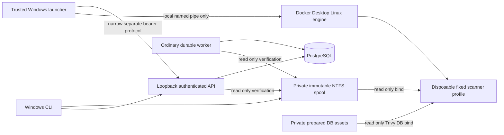

# Phase 2B execution boundary

Phase 2B adds local security analysis to the accepted Phase 2A foundation. It does
not add agent tools, hosted providers, human review, remediation, UI or SOC features.
The local Windows operator, platform policy, Docker Desktop and launcher are trusted.
Every acquired source byte and every scanner output byte is untrusted.

## Authority and ownership

The API, workers and scanners have no Docker socket, Docker API endpoint, Docker
client library or daemon credentials. `runner/` is host-only and excluded from the
application build context. The launcher resolves fixed executable/arguments/images,
mounts and resource settings from trusted code and `policies/scanners.lock.json`.
There is no public command, image, executable, mount or container-options parameter.
Subprocess calls use argument arrays and `shell=False`; only trusted tooling runs.

The host executable must resolve outside this repository. The context is fixed to
`desktop-linux`; readiness requires the exact local Docker Desktop named pipe,
Linux engine and Docker Desktop identity. Environment variables capable of overriding
the Docker endpoint or injecting application credentials are not inherited by its CLI.

The launcher authenticates with an independent generated local bearer. Public operator
credentials cannot call internal launcher routes; launcher credentials cannot call
public application routes. Internal requests reject every browser Origin. The bearer
is a privileged capability: protect the ignored configuration and host account.

`security-v1` admission requires explicit configuration and a launcher heartbeat no
older than 15 seconds matching the registry digest. Default admission is disabled.
The launcher verifies the recorded G4 proof against current boundary code and local
engine identity before advertising availability. This is a trusted local evidence
check, not remote attestation or protection from a compromised operator.

## At-least-once compute and fenced publication

1. Existing transactional acceptance resolves `security-v1` to the exact registry
   digest and creates independent Semgrep/Trivy scanner slots and durable jobs.
   Existing database idempotency constraints and semantic replay behavior remain.
2. The ordinary worker claims with `SKIP LOCKED`, advances the attempt generation,
   obtains a unique token and heartbeats independently. Real attempts have a bounded
   180-second default deadline; fake attempts retain their established policy.
3. Under the current job lock and ownership predicate, it creates a unique
   `(job_id, generation)` handoff. Handoffs carry identities, source manifest digest,
   fixed profile name and registry digest. They carry no caller-selected paths.
4. The host polls through the API, verifies the native snapshot again and executes
   one container at a time. It checks ownership before/during execution; uncertainty,
   expired leases and stop requests terminate the owned container.
5. The API validates sanitized normalized output and provenance outside the ownership
   transaction, then locks job followed by handoff and checks fresh database time,
   generation, token, launcher identity, deadline and running state before staging.
6. The worker revalidates source, output and provenance, then publishes findings,
   scanner state, parent state and audit events in its existing fenced transaction.
   Launcher staging alone cannot publish authoritative results or completion events.

Completion and recovery retain the established job-first lock ordering. Expired
attempts cannot renew themselves or stage/publish results. Duplicate computation can
occur; exactly-once compute is not claimed. Replacement launchers acquire an exclusive
private host lock, remove only exactly labelled owned orphans, then reconcile prior
handoffs through a bounded API operation. Recoverable launcher failures use existing
backoff/three-attempt bounds. Hard scanner failures are visible terminal outcomes.

## Fixed execution profile

Both real scanner images run by immutable local image ID with `--pull never` and
`linux/amd64`: UID/GID 10001, read-only root and source, no network, all capabilities
dropped, no-new-privileges, no application/database/model credentials or daemon mount.
Limits: 1 CPU, 1024 MiB memory with no additional swap, 64 processes, 1024 file handles,
no core dumps, 32 MiB `/tmp`, 64 MiB `/work`; Trivy also has 64 MiB `/cache` with only
the prepared DB subdirectory mounted read-only. Temporary mounts are noexec/nosuid/nodev.
Containers have no writable host output mount, no restart policy and no Docker log
storage. Attached stdout/stderr are bounded to 4 MiB/64 KiB; overflow terminates.
The host execution budget is 90 seconds, with Trivy's own 80-second deadline as another
bound. Polling/control requests and bounded daemon calls add termination latency;
this is not a real-time 90.000-second wall-clock guarantee. An unavailable daemon
requires operator recovery. Abrupt host process death leaves an owned container until
launcher restart/reconciliation; Docker has no independent per-container TTL here.

Native source acquisition and Linux read-only bind mounts are tested as distinct
boundaries. The launcher resolves only opaque validated spool keys. It never converts
a caller-provided Windows path into a container mount. Per-execution tmpfs workspaces
and invocation identities prevent output reuse between attempts.

## Trusted audit policy and coverage

The trusted wrapper copies bounded snapshot bytes into an ephemeral audit view without
importing, executing, building or installing target code. It omits repository ignore
and scanner-policy files. Semgrep uses eight first-party pinned rules, disables inline
`nosem` suppression, configuration discovery and telemetry. Trivy uses trusted config,
secret rules, built-in pinned-image Dockerfile/Kubernetes checks, an empty ignore file,
disabled updates/telemetry and an offline vulnerability database. Trivy suppression
tokens are neutralized with equal-length bytes in the derived view; original snapshots
and line numbers are preserved. Policy-file and suppression counters are recorded.

Semgrep covers representative Python/JavaScript injection patterns and selected GitHub
Actions guardrails. Trivy covers validated pinned Python requirements and npm lockfiles,
selected Dockerfile/Kubernetes misconfiguration, and a synthetic AWS-access-key-shaped
secret pattern. It does not fetch packages, analyze built container images or resolve
dependencies online. Terraform and additional dependency formats are not validated;
recognized unsupported formats produce incomplete coverage, not a clean assertion.
The pinned Trivy build has no GitHub Actions parser, so CI coverage belongs to Semgrep.

Normalization bounds JSON size/depth/nodes/strings, finding count (200 per real scanner),
paths, line ranges, metadata and staged output (512 KiB). It rejects malformed output,
untrusted Semgrep rule IDs and evidence outside the immutable manifest. It stores
constant descriptions and allowlisted metadata, never raw scanner messages, snippets,
secret Match/Code values or raw output files. Secret values exist transiently in scanner
memory/attached output and are discarded. Sanitization does not promise to identify
every arbitrary secret encoded in a filename or allowed package metadata.

Per-scanner outcomes include explicit coverage and provenance. Parser errors retain
valid findings but mark the scanner failed with `incomplete_coverage`; a successful
peer can make the parent `partial`. Missing/stale DB, unsupported inputs, output
overflow and execution failure do not become clean scans. A successfully published
incomplete result can have a successful durable job while the scanner slot is failed:
job success means publication, not security approval. `complete_detection_claim` is
always false. Tracking fingerprints exclude per-run identity and line movement;
occurrence keys additionally distinguish location/version. They are aids, not proof
of semantic equivalence across renames or changed vulnerability context.

## Remaining trust and operational limits

Docker Desktop VM/kernel, scanner image supply chain, the host account and Docker
daemon remain trusted. Containers are not a dedicated hostile multi-tenant VM boundary.
One launcher and sequential scanner execution are intentional MVP limits. Proof must
be rerun after engine/boundary/filesystem changes; scanner/DB refresh requires revalidation
and coordinated registry deployment. Historical pending work is not silently repinned:
unavailable accepted registry resolution fails visibly. Published snapshots, DB assets
and historical images are retained; no new garbage collector is implemented. Existing
quotas/retention remain, and failures at quota require operator action without deleting
referenced data. API/worker have independent trusted DB authority; fencing protects
against stale attempts, not a fully compromised trusted service.
