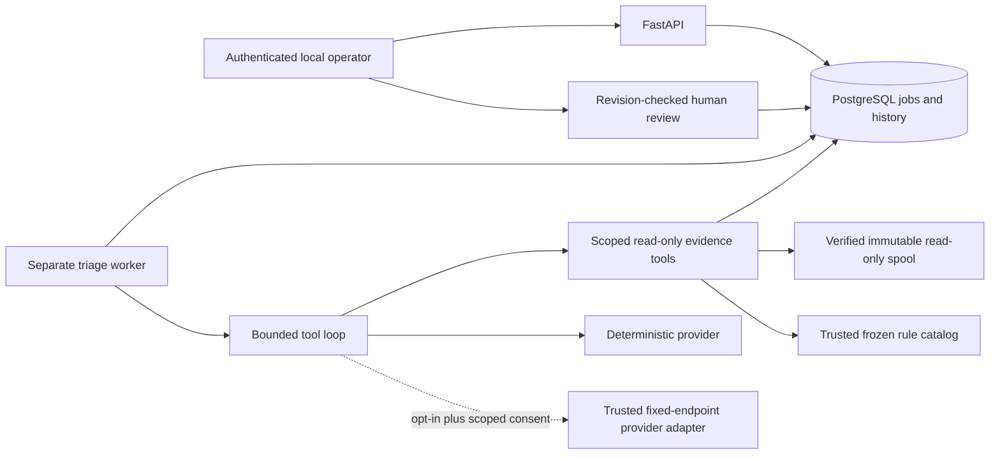

# Phase 3 bounded triage and human review

Phase 3 extends the approved local AppSec platform. It adds no autonomous fixes,
scanner execution tools, UI, SOC features or expanded Phase 4 benchmark. The offline
provider is deterministic; hosted transport is optional, disabled and not exercised
against an external model under this authorization.

## Components and authority

`agent/` owns contracts, confidentiality/prompt policy, tools, providers and the small
explicit loop. `jobs/triage.py` extends the existing controller and shared jobs/attempts;
`jobs/triage_worker.py` is a separate process. `storage/triage.py` owns atomic acceptance,
consent and review. Existing scanner workers claim/recover only `scan` jobs, triage
workers only `triage` jobs. AI outcomes never update scanner results or findings.

The model selects only one of five fixed function names with strict argument schemas:

| Tool | Arguments and enforced scope |
| --- | --- |
| `finding` | Exact target finding UUID; normalized bounded metadata, no scanner message/excerpt |
| `source` | Exact target finding UUID plus start/end lines; server derives file from finding and immutable snapshot; range within finding +/-5 lines and at most 20 lines |
| `rule` | Exact target finding UUID; platform rule definition, CWE, guidance and recorded scanner provenance |
| `coverage` | Empty object; target scanner outcome and coverage |
| `context` | Limit 1–5, default 3; same scan and same file, metadata only |

There is no path/root, URL, command, executable, plugin, credential or scanner argument.
Tool authorization is code, independent of instructions. Actual source bytes are
verified through the established spool verifier before excerpt retrieval; no DB
transaction/connection remains held during filesystem or provider work. Unknown or
unavailable source is never substituted from another scan. Context queries have LIMIT.

Rule definitions are frozen from the existing trusted Semgrep YAML into
`policies/triage-rules.json`, with the original source hash and scanner policy digest.
The catalog is checked against the unchanged scanner registry, included in application
images and bound into triage configuration identity. A historical policy mismatch is
visible and makes the deterministic provider abstain. Other rule families remain
unsupported by this narrow offline reasoning path. Target repository policy is never
loaded as authority. Scanner images/rules/DB and the G4 boundary remain unchanged.

Each evidence object includes snapshot UUID, manifest digest, path, line range, kind,
redacted-content digest and an evidence ID binding these values. Final citations must
exactly equal references actually retrieved in this investigation. Non-abstaining
results require both finding and source citations. This validates identity and location,
not semantic entailment of every natural-language claim; human assessment and Phase 4
quality evaluation remain necessary.

## Bounds and confidentiality

| Budget | Default bound |
| --- | --- |
| Tool calls / provider steps | 8 / 10 |
| Source lines / excerpt bytes | 20 / 4096 |
| One evidence response / aggregate context | 8192 / 24576 bytes |
| Provider output | 2048 tokens; transport response at most 65536 bytes |
| Conservative token reservation | 320000 per attempt; hosted reservations also bounded across retries |
| Investigation / single provider call | 20 seconds / at most 5 seconds |
| Hosted estimated reservation | 250000 micro-USD ($0.25), across attempts |

Token accounting reserves serialized input bytes plus framing and the full output cap;
it is a conservative bound, not a tokenizer measurement. Price assumptions are versioned
configuration, not a measured invoice or guarantee against provider pricing changes.
All hosted send reservations persist under lease and consent locks, so retries cannot
reset the operation's call/token/cost allowance. Three durable job attempts remain the
default. There are no hidden transport retries. At-least-once calls can incur duplicate
billing after uncertain responses; no exactly-once external execution claim is made.

Provider calls run behind a wall-clock watchdog. If a provider thread remains blocked,
the worker records a fenced retryable failure where still owned and exits before
accepting another job; operator restart is required. The abandoned daemon thread cannot
publish results. Independent heartbeats continue during normal provider work; expired
ownership cannot revive itself. Trusted filesystem/DB/OS scheduling still affects total
shutdown latency, and already transmitted requests cannot be recalled.

Raw source is private data, even in authorized snapshots. Secret findings return a
redacted location marker instead of source. Other excerpts redact known synthetic/key
families, long opaque tokens and credential-shaped assignments before provider input.
Provider output and reviewer notes become bounded plain text with HTML escaped,
Markdown links neutralized and terminal controls removed. Prompts/results contain no
provider key, bearer, DSN or lease token. Traces store only sequence, tool name, byte
count and evidence hash; no tool arguments, raw excerpts, prompts or raw provider output.
Failures persist safe categories/attempt history, not raw exception messages.

Heuristic redaction is not complete DLP. Unfamiliar encodings, proprietary code, personal
information or secrets outside recognized patterns can remain in a permitted excerpt.
Hosted consent explicitly acknowledges this risk; default operation remains offline.
Future UI must render these strings as inert text rather than trusted HTML/Markdown.

## Provider behavior and consent

The deterministic provider genuinely inspects finding, source, trusted rule, coverage
and limited context. Its decision changes for a literal eval, variable eval or unrelated
source. It supplies conservative review guidance or abstains; fixed confidence values
are not calibrated exploit probabilities or production model-quality evidence.

`openai-v1` uses the fixed HTTPS Responses endpoint, pinned model
`gpt-5.4-mini-2026-03-17`, explicit function schemas and structured final output. It
declares no built-in shell, browser, search, code execution or external plugin tool.
Redirects and environment proxies are disabled. Requests are stateless with `store:false`
and no background processing. This setting does not establish a zero-retention agreement
with the provider. HTTP timeouts, rate limits, unavailable services, malformed/refused/
incomplete responses and extra/invalid tool calls are safe explicit failures.

Hosted operation requires all of:

1. Trusted opt-in configuration (`ASP_HOSTED_ENABLED`, default false).
2. Explicit consent for this operation UUID, finding/scan/snapshot IDs, manifest hash,
   provider/model/prompt/tool/catalog/confidentiality/budget configuration digest, and
   the full permitted category set.
3. A current job lease and a fresh consent check/reservation immediately before each send.
4. A provider key confined to the trusted triage provider process, never supplied to
   API, ordinary scan workers, scanners, launcher, model messages or reports.

Consent is revoked through a locked API transition. Revocation prevents subsequent
send reservations; it cannot retract an in-flight authorized request or prior disclosure.
Replay returns the accepted triage resource but grants no new send authority. Changed
source/configuration or a different operation cannot reuse the consent. The operation
UUID and unique acceptance/idempotency constraints prevent duplicate resources.

The base Compose definition supplies no hosted key, and no local hosted key was created.
All hosted validation used mocked transport; no external model call, source transmission
or paid use occurred. Live hosted validation needs separate authorization.

## HTTP contracts

Existing bearer, exact Host/Origin, request limits, safe errors and signed scan/finding
pagination remain. PUT preflight is added only for review paths; DELETE only for consent
paths. New write bodies forbid unknown fields, including spoofed reviewer/actor fields.

| Route | Contract |
| --- | --- |
| `GET /api/v1/triage-config` | Public-to-authenticated-operator versioned configuration digests/budgets; no keys |
| `POST /api/v1/findings/{id}/triage` | Body `{provider?, operation_id?, consent_id?}` plus bounded `Idempotency-Key`; atomic 202 ID/Location; identical replay returns original; conflicting payload 409 |
| `GET /api/v1/triage-runs/{id}` | Independent queued/running/succeeded/unavailable/failed state, safe error or validated assessment/citations/trace/usage; `human_decision:false` |
| `POST /api/v1/hosted-consents` | Explicit operation/finding/config/categories and literal JSON `true` risk acknowledgement; 201; disabled/incomplete scope 403, duplicate operation 409 |
| `DELETE /api/v1/hosted-consents/{id}` | Idempotent revocation; 404 unknown consent |
| `GET /api/v1/findings/{id}/review` | Current revision/disposition/note, or revision 0 and no disposition |
| `PUT /api/v1/findings/{id}/review` | `{expected_revision, disposition, note?, triage_run_id?, feedback?}`; first revision expects 0; stale write 409 |
| `GET /api/v1/findings/{id}/review-revisions` | Bounded descending revision history, `before_revision` and limit <=100; next key if more |

Finding detail now includes separate latest-triage/current-review summaries. Existing
finding pagination adds an optional approved disposition or `unreviewed` filter. Old
unfiltered cursor payloads remain unchanged. Mutable review-filter membership is not
a historical snapshot. Human history uses a bounded natural revision key without OFFSET.

Dispositions retain Phase 0 vocabulary: `confirmed` (accept alert), `false_positive`
(reject alert), `investigate`, `accepted_risk`, `remediation_planned`. Optional structured
feedback (`agree`, `disagree`, `uncertain`) must reference this finding's successful
triage. Reviewer identity is server-controlled `local_operator`. The API never copies
an AI opinion into a human disposition automatically.

## Persistence and fencing

Forward revision `0004_triage_review` adds `triage_runs`, `hosted_consents`,
`triage_outcomes`, `triage_provider_calls`, `reviews`, `review_revisions`. It reuses
`jobs` and `job_attempts` for triage attempts and extends `idempotency_requests` with an
exclusive triage/scan target. Job constraints require exactly the target appropriate
to operation; triage has a unique job. Composite finding/scan/snapshot/manifest foreign
keys enforce scope in PostgreSQL. Consent/operation and review/finding/revision keys
are unique. JSON outcomes, traces, usage and consent categories have database bounds.

Claims use real `FOR UPDATE SKIP LOCKED`; generations/tokens and DB-time expiry retain
their prior semantics. Completion, failure, recovery and send reservation lock job first,
then triage, then consent if needed. Final outcome, attempt/job/triage status and audit
commit under the same ownership fence. Stale attempts publish no outcome or completion
event. Recovery has authority from the locked expired job. Scan/scanner/finding rows
are never part of triage publication mutations.

Human writes lock the finding (including first-write races), compare expected revision,
then atomically update current review, append immutable revision and audit. PostgreSQL
triggers reject UPDATE/DELETE of revision history. Trusted DB administrators can still
alter schema/triggers; this is not cryptographic tamper-proofing. Disposable fixtures
use guarded TRUNCATE for cleanup, never a production history-deletion API.
