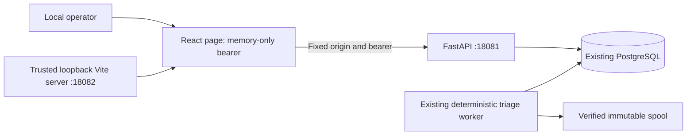

# Phase 6 dashboard architecture and contracts

The dashboard is a local presentation and explicit review layer over the accepted
AppSec platform. There is no new scanner, agent, auth service, queue, proxy, database
table, migration, aggregate-metrics endpoint or infrastructure service.

Only browser-origin configuration changes on the backend. `compose.yaml` adds exactly
`http://127.0.0.1:18082` to the API allowlist, preserving previous allowed origins and
Host values. API remains published only on loopback; PostgreSQL has no host port.
New API tests prove allowed-origin access still requires bearer authentication,
review PUT preflight remains constrained, unapproved/null origins are denied, and
launcher routes remain unavailable to browser origins. No backend source code or API
response contract changed. Database revision remains `0004_triage_review`.

## Frontend ownership and versions

| Module | Responsibility |
| --- | --- |
| `web/src/App.tsx` | Session, explicit project UUID lookup, history, scan lifecycle, filters, findings and selected evidence |
| `api.ts` | Private in-memory bearer, fixed endpoint methods, request/response bounds, safe errors/redaction, disconnect abortion |
| `contracts.ts` | TypeScript response types and explicit coverage/status formatting |
| `components.tsx` | Status, provenance/coverage, pagination and stale-response/view ownership |
| `Investigation.tsx` | Explicit offline submission, bounded status polling, assessment/abstention and citation identity checks |
| `Review.tsx` | Human draft, confirmation, expected revision, explicit conflict recovery and immutable history |
| `main.tsx`, CSS | Safe application root and responsive layout; no rendering of untrusted HTML |
| `vite.config.ts` | Exact local Host/Origin boundary, loopback binding, private-file denial and security headers |
| `web/tests/` | Chromium live/API workflows, scripted failure/hostile content and sanitized reporter |

Exact direct versions: React/React DOM **19.3.1**, TypeScript **7.0.2**, Vite **8.3.5**,
Playwright **1.64.1**, React/React DOM types **19.3.0**, Node types **26.6.5**.
Validated host: Node **24.22.1**, npm **11.19.1**; package engines require Node
24.22.1 through 24.x. The version-3 npm lock pins transitive dependencies/integrities.
`npm ci --ignore-scripts --no-audit` succeeded; install lifecycle scripts remain disabled
in `.npmrc`. No component library, router framework, Markdown renderer, chart library,
general agent framework or Python runtime dependency was introduced.

The installed Chromium headless shell is **156.0.8078.4**, Playwright revision **1248**,
with browser files in ignored `.cache/phase6-browsers`. These are test dependencies,
not a browser packaged into application images. The frontend is served by a trusted
host development toolchain; it is not claimed to be an OS sandbox.

## Authentication and request authority

The operator supplies a bearer token in a password field. After validation the token
is held only in an `Api` instance's private field, and the form value is cleared.
No token is embedded in source, bundles, default config, URL, Docker images, browser
local/session storage, IndexedDB, cookies, Cache Storage or service workers. Disconnect
clears the credential field, aborts pending fetches and unmounts loaded records. Reload
requires authentication again. This is logical reference clearing, not a claim of
cryptographic erasure from browser/OS memory; the local browser/operator remain trusted.

The client uses the fixed `http://127.0.0.1:18081` API origin. There is no operator-
or model-selected destination, generic URL tool or server proxy. Requests omit cookies,
reject redirects, use no-store/no-referrer and CORS mode, and never put tokens in query
strings. UUID paths are validated; filters/cursors use URLSearchParams. Requests have
a ten-second deadline and responses a streamed 4 MiB limit. Closed sessions reject
further requests. Error views use fixed messages, never raw response bodies/exceptions.
Known credential formats and the current bearer are removed from returned display data.
This extra guard is not complete secret detection; existing API sanitization remains
the primary metadata boundary.

Vite binds only `127.0.0.1:18082` with strictPort; an occupied port fails rather than
silently changing the origin. Exact Host and optional Origin are checked. CORS is false,
filesystem access is limited to `web/`, and configuration, instruction, Git, local-data
and test-source files are denied. Client environment files/prefix exposure are disabled.
Build assets contain no source maps or known local credentials. See the official
[Vite server options](https://vite.dev/config/server-options) for the distinction between
Host validation, CORS and filesystem restrictions.

Both dev and preview emit no-store, nosniff, no-referrer, frame-ancestors/object/base
denial and a restrictive CSP. Development permits inline **styles** for Vite CSS injection
and the local HMR WebSocket. Neither mode allows inline scripts or unsafe-eval; preview
also omits inline styles/WebSocket allowance. Vite's normal cache header cannot override
the no-store policy. No remote fonts, images, analytics or model SDKs are used.

## Views and HTTP mapping

One root SPA with explicit in-memory views; no token-bearing routes or persistent
navigation state. Project UUIDs come from the existing CLI. This avoids a new project
listing endpoint, without treating project IDs as authorization in this single-user API.

| View/action | Existing HTTP contract |
| --- | --- |
| Connect | GET `/api/v1/triage-config` |
| Open project UUID | GET `/api/v1/projects/{id}` |
| Scan history | GET `/api/v1/scan-runs?project=...&limit=3&cursor=...` |
| Scan lifecycle/scanner coverage | GET `/api/v1/scan-runs/{id}` |
| Filter/paginate findings | GET `/api/v1/scan-runs/{id}/findings?limit=10&severity=...&scanner=...&rule_id=...&review=...&cursor=...` |
| Finding metadata/source reference/latest summaries | GET `/api/v1/findings/{id}` |
| Explicit offline investigation | POST `/api/v1/findings/{id}/triage`, body `{"provider":"deterministic-v1"}` and per-action Idempotency-Key |
| Investigation status/result | GET `/api/v1/triage-runs/{id}` |
| Current review | GET `/api/v1/findings/{id}/review` |
| Confirm review | PUT review with expected_revision, supported disposition, optional note and scoped triage feedback |
| Immutable revisions | GET review-revisions with limit=5 and natural before_revision key |

There are no UI source acquisition, scan submission, consent creation, hosted execution,
source editing, shell/URL retrieval, Docker control, remediation or upload functions.
CLI/server scanning and policy/export behavior remain independent.

History and finding pages preserve server cursors and permit previous/next navigation.
Changing filters resets cursors and selection. A response identity/generation guard
prevents old records/pagination controls from appearing under a new query identity;
late responses cannot replace another view. Background scan refresh preserves the
mounted investigation/review draft and focus for the same scan. Previously loaded metadata
is explicitly marked stale if refresh fails; selecting another finding/view or reloading
still discards unsaved in-memory drafts. Mutable review-filter membership is still
not a historical snapshot; the UI labels this and provides explicit refresh.

Succeeded, partial, failed, queued and running states are separate. Scanner completion
requires its own succeeded state, explicit complete_execution, and no unavailability or
coverage warnings. Successful execution still carries limited detection coverage.
Unknown/pending coverage is not clean. Scanner-specific errors, coverage and provenance
remain visible; detailed metadata is expandable. Synthetic diagnostics have conspicuous
labels in scanner cards, finding rows and investigation details.

## Triage and human authority

Viewing a finding does not create triage. The operator must press Investigate offline;
there is no hosted provider selector. An uncertain acceptance response retains the
idempotency key for a same-action retry. Existing pending investigations can be read.
Polling uses fixed GETs, stops on failure/terminal status/view departure/session closure,
and pauses after two minutes with an explicit refresh control. Pending scan detail
refresh is similarly bounded. A provider failure does not change scanner results.

Results display provider identity, offline limits, assessment, explanation, reason,
uncalibrated confidence, abstention and advisory remediation. Actual unsupported families
may return the existing insufficient_evidence reason; the UI does not relabel backend
results or expand reasoning capability. It explains possible unsupported rules and the
need for human investigation. Historical hosted results, if present, are labelled as
such; the dashboard never starts a hosted request.

Citations are returned from the backend's validated evidence workflow. The client also
checks selected snapshot/manifest/path, permitted evidence kind, digest shape and valid
line range before displaying them as matching references. No arbitrary links are created.
The page retrieves metadata/citations, not raw source excerpts or complete snapshots.
Server validation at investigation time is distinguished from client byte verification;
valid identity/citations do not prove remediation advice is semantically supported.

Dispositions are exactly confirmed, false_positive, investigate, accepted_risk and
remediation_planned. Notes are optional and bounded to 2,000 characters. Optional
agree/disagree/uncertain feedback references this finding's succeeded triage result;
changing the triage operation clears feedback selection. Reviewer identity remains
server-controlled local_operator.

Review and save opens a confirmation region showing disposition, note and revision.
Only Confirm review writes. A 409 fetches current server review, preserves the draft,
displays the current decision and blocks writes. Load server review or Reconsider draft
with current revision is required before another explicit confirmation. Failed refresh
leaves saving blocked. There is no automatic overwrite/retry and no AI-to-human decision
copy. Revision history stays append-only on the server and paginates five entries at a time.

## Metrics, rendering and limitations

History cards count only the loaded page (at most three scans). Finding severity,
high/critical and synthetic counts use only the loaded filtered page (at most ten
findings). Human disposition/history and pending/failed triage refer to the selected
finding. Dates are persisted timestamps rendered in browser local time. There are no
global totals, invented trends, composite risk score, disappearance-as-fix claim or
inference that a clean result guarantees security.

All descriptions, paths, source references, notes, provenance, model text and Markdown
are JSX text. No dangerous HTML API, Markdown interpretation, arbitrary href, script
execution or automatic remediation exists. Backend escaped strings remain text; entities
may be visible literally. Safe rendering does not make arbitrary metadata non-sensitive.
The frozen Kubernetes annotation errata, unsupported/incomplete coverage, limited offline
provider and A13 advisory-quality limitation remain unchanged and visibly advisory.
