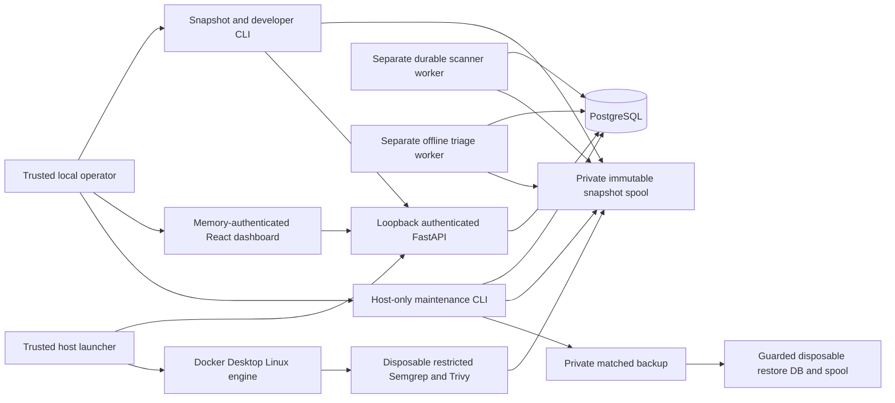

# Final local architecture

Phase 7 preserves the approved Python/PostgreSQL, fixed scanner launcher and bounded
agent design. The primary product is AppSec investigation and developer guardrails;
secure AI evaluation and durable backend processing support that product.

Disposable ordinary/triage workers explicitly receive no launcher capability; their API
keeps the independent verification credential. The same separation remains in development.

The maintenance CLI, launcher, local operator, build toolchain, Docker Desktop and DB
administrator belong to the trusted computing base. API, ordinary workers, triage
tools and scanner containers have no Docker endpoint or generic host-execution proxy.
The maintenance modules live under `scripts/`, outside the runtime image and HTTP API.

## Preserved behavior

- Python 3.12.15 / uv 0.13.5; synchronous FastAPI/SQLAlchemy sessions; explicit Alembic
  migrations. PostgreSQL 17.11; current revision remains **0004_triage_review**.
- At-least-once scanner/triage execution with SKIP LOCKED, token/generation/expiry
  fences, independent heartbeat, bounded retry/backoff and transactional publication.
  Findings, authoritative status and completion audit events share the ownership fence.
- Fixed digest-pinned Semgrep 1.179.0 and Trivy 0.76.1 profiles. Preparation can obtain
  public assets; execution is non-root, offline, read-only and resource bounded.
  Per-scanner coverage, partial outcomes and historical provenance remain independent.
- Snapshot IDs resolve only inside the immutable spool. All acquired contents and
  scanner/model output remain untrusted data. No target installation, hooks or execution.
- Explicit deterministic investigation; read-only application-authorized evidence tools;
  snapshot/path/line citations and abstention. Hosted execution remains disabled.
  Human decisions require explicit action, expected revision and immutable audit/history.
- React 19.3.1 / TypeScript 7.0.2 / Vite 8.3.5; fixed loopback UI/API addresses, in-memory
  bearer, restricted CSP, inert text rendering and page-scoped metrics. No UI redesign.
- CLI policy codes remain 0/pass, 1/finding-policy failure, 2/incomplete or operational
  failure. AI opinions never determine scanner policy. JSON/SARIF remain bounded.

## Phase 7 decisions

| Decision | Implementation and evidence |
| --- | --- |
| Bound source lifecycle without losing history | Retain every registered snapshot, including expired ones; protect all transitive scan/job/finding/triage/review references. Only unregistered publications older than the maximum seven-day intake lifetime can be explicitly reclaimed. [Retention proof](retention-evidence.json) |
| Make cleanup reject link/substitution hazards | Validate a complete bounded tree before mutation. NTFS ancestors/children remain pinned with no competing write/delete sharing; delete through owned handles. POSIX uses no-follow descriptors, identity checks and relative deletion. [Tests](../../tests/unit/test_lifecycle.py) |
| Keep backups matched | Hold the publisher lock and SHARE locks on all application tables plus Alembic. Capture a custom PostgreSQL dump, all published snapshot bytes/manifests, trusted policy metadata and table fingerprints. Write the integrity manifest last. [Recovery contract](RETENTION-AND-RECOVERY.md) |
| Restore into fresh destinations | Exact database/user/Compose labels and private spool checks; no retained target. An empty or exactly matching destination can resume; incompatible data is never overwritten. Explicit 32-hex instance IDs create separate disposable namespaces. |
| Lock the isolated Python build toolchain | Six exact version and archive-hash constraints in pyproject/uv.lock; runtime package versions unchanged. No additional runtime dependency. [Build toolchain](build-toolchain.json) |
| Bound generated reports | Serialize exclusive publication; 64 retained files / 64 MiB, 4 MiB per report. Preserve exports and unknown temporary files; refuse unsafe entries and exhausted storage. |

No new HTTP endpoint, response contract, schema migration, scanner engine, model tool,
agent framework, external connector or automatic remediation was introduced.

## Restore and confidentiality boundary

Backup checksums detect corruption against an operator-trusted manifest digest; they
are not signatures or protection against a compromised host administrator. Restoring a
trusted PostgreSQL dump executes database definitions, so this is not an arbitrary
backup-upload service. See the official [PostgreSQL restore warning](https://www.postgresql.org/docs/17/app-pgrestore.html).

Private source and DB contents never appear in published restore evidence. Credentials
are generated separately for disposable targets and excluded from backups. The 1.63 GB
public vulnerability database and scanner images remain separately retained assets,
identified by immutable hashes; backups preserve their provenance, not executable image
archives. Source/DB history can be restored offline; rescanning requires matching approved
assets or a separately validated preparation update. Missing evidence fails closed.

See [final threat model](THREAT-MODEL.md), [findings](FINDINGS.md), [runbook](RUNBOOK.md)
and [the controlled demonstration](DEMONSTRATION.md).
