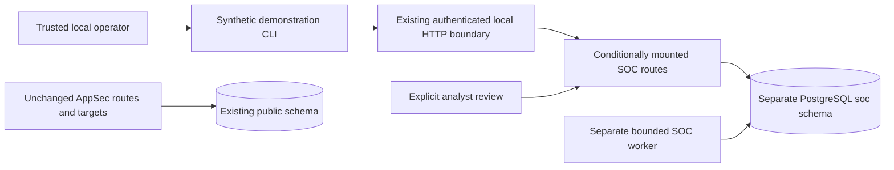

# Optional synthetic SOC extension

The flagship remains the AppSec product. This extension supplies a bounded backend
simulation for Prophet-oriented demonstrations. It adds no scanner, AI agent, external
connector, automated response or frontend. `Settings.soc_enabled` defaults to false.
The normal Compose configuration does not activate or migrate SOC.

## Boundary and orchestration decision

Phase 0 requires independent SOC metadata/migrations and no required SOC fields or
imports in AppSec records. Accordingly, `soc.models.Base` owns eight tables in schema
`soc`: `datasets`, `security_events`, `correlation_runs`, `jobs`, `job_attempts`,
`investigations`, `analyst_feedback` and `audit_events`. None references an AppSec table.
The optional migration has its own `soc.alembic_version`, revision **soc_0001**.
The public revision remains **0004_triage_review**.

The existing PostgreSQL orchestration protocol is reused with module-owned job targets
and attempts. This is the same SKIP LOCKED/token/generation/heartbeat/backoff mechanism,
not an additional queue service or event-processing framework. Shared ownership predicates
and lease clearing live in `jobs/ownership.py`; the existing AppSec controller delegates
to them with unchanged semantics. SQL target transitions remain local to each module.
There are no SOC discriminator columns in public jobs and no SOC completion events in
the AppSec audit table. That separation makes physical module and schema removal testable.

Lock order is SOC job, correlation run, attempt. Claim, heartbeat, failure and recovery
sample database time after locking. Completion recomputes the bounded result from
server-owned input events, checks current ownership, inserts investigations and publishes
run/job/attempt/audit changes in one transaction, with another fence after insertion.
An expired or replaced token cannot heartbeat, publish evidence, complete or append its
completion audit. Compute is at least once; authoritative publication is fenced.

Each accepted batch creates one durable correlation run/job. Its event-ID set and rule
digest are immutable. Later arrival never rewrites an earlier investigation. A new batch
key captures a new run, possibly sharing a tracking identity with an earlier occurrence.

## Input and identity contracts

Both Pydantic schemas use version 1, reject unknown fields and normalize timestamps to
UTC. A batch contains 1–20 events and remains subject to the existing 16 KiB HTTP limit.

| Field | Contract |
| --- | --- |
| Dataset | Explicit UUID; label `synthetic-demo` or `synthetic-test`; no AppSec project FK |
| Common fields | `version`, `format`, `source_id`, `event_id`, `actor`, `occurred_at`, optional `session_id` |
| Identity adapter | `format=identity-v1`, `source_id=synthetic-idp`; authentication_failed/authentication_succeeded/access_denied |
| Cloud adapter | `format=cloud-iam-v1`, `source_id=synthetic-cloud`; admin_granted/permission_removed/readonly_granted; required synthetic `resource` |
| Identifiers | Lowercase bounded tokens; actor/session/resource prefixes are mandatory; no real usernames, emails, URLs or credential fields |
| Time | Timezone required, years 2020–2099; no more than five minutes ahead of database time |
| Provenance | Validated canonical input including adapter/version, SHA-256 payload digest, event time, ingestion time and source identity |

The two typed adapters deliberately expose a small common vocabulary. No raw arbitrary
payload is retained. SQL constraints bound canonical JSON, source identities and digest
shape. Event UUIDv5 derives from dataset/source/external event ID. PostgreSQL also enforces
unique `(dataset_id,source_id,external_id)`; a same-identity different payload returns 409.

Batch idempotency is unique `(dataset_id,idempotency_key)`, with a hash of normalized
events sorted by source/identity. Ordering, omitted default values and equivalent UTC
timestamps do not create distinct semantic requests. Duplicate identities inside one
batch are rejected. Exact replay returns the original acceptance, including its original
counts; it does not create a second job. A new batch key containing already stored events
reports duplicates and creates an explicit new correlation run.

Ingestion serializes on the dataset row. Events, acceptance record, run, job and initial
audit commit atomically. `delayed` means ingestion more than one hour after event time;
`out_of_order` means earlier than the maximum event time present before this batch.
These are diagnostics, not statements about causation or producer clock accuracy.

## Versioned rules

| Rule | Match | Incomplete/clean behavior |
| --- | --- | --- |
| auth-burst-success-v1 | At least three failed authentications strictly before a success, within 600 seconds, same dataset/actor | Fewer than three is not a match; retain at most the most recent 20 failures plus anchor |
| session-admin-grant-v1 | Admin grant and a strictly earlier successful authentication within 900 seconds, with identical actor and non-null session ID | An admin grant lacking matching authentication is explicitly incomplete, not confirmed compromise |

Timelines order by `(occurred_at,id)` and link exact event IDs, hashes and timestamps.
The grant rule retains the latest matching authentication plus the grant. There is no
cross-dataset correlation. Similar timestamps alone cannot establish association.
Neither rule establishes malicious intent, account compromise or a causal chain.

Each run permits 1–1,000 events and at most 200 investigations; exceeding the outcome
budget fails the run rather than publishing a truncated apparently clean result.
`tracking_id` hashes rule/anchor identity; `id` is a per-run investigation occurrence.
Rule configuration digest and versioned IDs are retained. Future semantic changes require
a new rule version and validation, not edits to historical evidence.

## HTTP contracts

All routes below are absent when disabled. Existing bearer, exact Origin/Host, body limit,
correlation IDs, no-store headers, safe errors and logging apply without modification.

| Method and `/api/v1/soc` path | Result |
| --- | --- |
| GET `/rules` | Trusted versioned rule metadata; no source content |
| POST `/datasets` | 201 create/replay explicit synthetic dataset; 409 conflicting label |
| POST `/datasets/{id}/events` | 202 durable acceptance; one Idempotency-Key required; 409 conflicting request/event |
| GET `/datasets/{id}/events` | Bounded ingestion-history page, default 50/max 100 |
| GET `/datasets/{id}/investigations` | Bounded investigation-occurrence history |
| GET `/runs/{id}` | Independent run/job status, attempts, safe failure code, rules digest and input count |
| GET `/investigations/{id}` | Rule, evidence references, evidence state and current human revision |
| GET `/investigations/{id}/timeline` | At most 21 matching normalized events; verifies dataset/hash/time; unavailable evidence fails closed |
| POST `/investigations/{id}/review` | Explicit disposition/note/feedback with expected_revision; 409 on stale revision |
| GET `/investigations/{id}/review-history` | Immutable descending revisions; limit/before_revision pagination |
| GET `/retention` | Non-destructive quota/retention inspection |

History reuses the existing signed cursor format: filter digest, last key, initial upper
watermark. Cursors cannot cross datasets or event/investigation endpoints. Keys above
the initial watermark are excluded. This is not an MVCC snapshot: a later commit with
an older creation key can become visible. Limits are enforced in SQL. Empty unknown dataset
history returns an empty page; direct unknown run/investigation returns 404. An enabled
SOC route needing missing/mismatched schema returns 503 while AppSec readiness remains
independent. Schema autogeneration explicitly excludes public/AppSec objects.

Dispositions are confirmed, false_positive, investigate and accepted_risk. Notes are at
most 1,000 characters and use the existing plain-text/redaction policy; feedback is useful,
incorrect or insufficient_evidence. A locked investigation enforces expected revision.
Current state, immutable revision and audit persist atomically. Database triggers reject
event/history/audit mutation and protect captured inputs and investigation evidence.

## Quotas, retention and confidentiality

At most 32 datasets, 1,000 events and 128 runs per dataset, and 1,000 review revisions per
investigation. Full quotas reject new admission; replay remains available. The 30-day
retention inspection reports old events, but all accepted events retain run/replay
references, so none is currently eligible for automatic deletion. There is deliberately
no destructive retention endpoint or background garbage collector. Storage is bounded;
this is conservative retention, not a guaranteed deletion deadline.

SOC has no source-spool, Docker, model or scanner capability. Its worker is a trusted
backend consumer using a database credential; schema separation is not database-role
isolation or multi-tenancy. The isolated demo uses separate generated local credentials
and its own volume. Inputs are synthetic labels only. Notes still use heuristic redaction,
which does not guarantee identification of every secret or personal detail. Do not ingest
real event streams or confidential identities. No source/model transmission is authorized.
